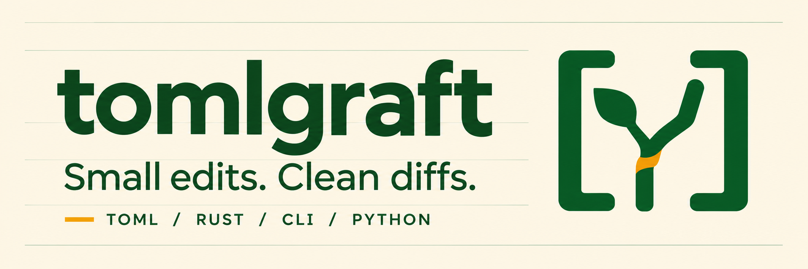

# TOMLGRAFT

[](#installation)
[](#python-and-rust)
[](LICENSE)

**Give your configuration a smaller diff.**

A one-line version bump should be a one-line diff. Rewriting a whole TOML file
can bury that change in reformatted values, reordered keys, or lost comments.

**tomlgraft** edits TOML and Python packaging metadata from your terminal, Rust,
or Python. It preserves untouched source bytes, validates the entire batch,
and lets you preview the diff before writing.

[See an edit](#see-an-edit) · [Installation](#installation) · [CLI](#cli) ·
[Python and Rust](#python-and-rust) · [Benchmarks](#benchmarks) ·
[Safety and preservation](#safety-and-preservation)

## See an edit

Bump a package version without losing its quotes or inline comment:

```sh
tomlgraft set pyproject.toml project.version "'1.4.2'" --dry-run --diff
```

```diff
 # Release metadata
 [project]
 name = "your-package"
-version = '1.4.1' # keep this comment
+version = '1.4.2' # keep this comment
```

This command works in POSIX shells and PowerShell. Remove `--dry-run --diff`
to apply it with the [atomic file writer](#file-transactions).

## Installation

From a source checkout, install the CLI with Rust 1.89+:

```sh
cargo install --path crates/tomlgraft-cli --locked
```

For the Python binding, build a wheel with CPython 3.12 and a Rust compiler/platform
linker, then install the matching wheel from `dist/`:

```sh
python -m pip install maturin==1.13.1
python -m maturin build --release --locked --out dist
# python -m pip install dist/<matching-wheel>.whl
```

The Python package provides the binding; install the CLI separately.
[Release notes](docs/releases/v0.1.0.md) describe planned binaries and wheels;
[registry installation](docs/reference.md#release-installation) applies once published.

## Why tomlgraft

Built for release scripts, configuration tooling, and automated pull requests
that people can review quickly.

| What you need | What tomlgraft does |
| --- | --- |
| **Focused diffs** | Preserves comments, key order, quote styles, line endings, and final-newline state outside the edit. |
| **Python packaging support** | Manages project dependencies, optional extras, dependency groups, and PEP 723 inline script metadata. |
| **All-or-nothing batches** | Validates ordered edits on a working copy. Invalid input or a failed operation produces no partial output or target write. |
| **Preview and CI checks** | Shows unified diffs with `--dry-run --diff`; mutation `--check` exits 6 when a change is needed. |
| **Atomic file writes** | Locks cooperating writers, stages output, and rechecks the target before replacement on supported local filesystems. |
| **Local operation** | Never runs Python, build backends, resolvers, subprocesses, or network requests. CLI, Rust, and Python share one core. |



## CLI

### Edit TOML values

Values are TOML literals; quoted path segments select keys containing dots:

```sh
tomlgraft set settings.toml 'tool."example.org".enabled' true --dry-run --diff
tomlgraft rm settings.toml tool.demo.enabled
```

For string values, use the version-bump example above; its quoting also works
in PowerShell.

### Manage Python dependencies

Add or update dependencies in `pyproject.toml`, including optional extras and
dependency groups. Matching uses normalized names, extras, and environment
markers, keeping distinct conditional variants separate.

```sh
tomlgraft dep add pyproject.toml 'pytest>=8' --group dev
tomlgraft dep add pyproject.toml 'httpx>=0.27' --optional test
```

The same commands work with PEP 723 inline metadata in standalone Python
scripts. Create a missing metadata block explicitly; the script is never executed:

```sh
tomlgraft dep add script.py rich --create-script-block
tomlgraft dep rm script.py requests
```

Recognized lockfiles stay read-only. Check their structure, then use your
resolver to regenerate them after dependency changes:

```sh
tomlgraft check pylock.toml --format json
```

### Apply an ordered batch

Save this as `changes.json` to update Python requirements and a development
dependency together:

```json
{
  "schema_version": 1,
  "operations": [
    {"op": "set", "path": ["project", "requires-python"], "value_toml": "\">=3.12\""},
    {"op": "dep_upsert", "scope": {"kind": "group", "name": "dev"}, "requirement": "pytest>=8"}
  ]
}
```

```sh
tomlgraft batch pyproject.toml --patch changes.json --check --format json
```

`--check` previews without writing and exits 6 when changes are needed. Remove it
to apply the batch. Use `--patch -` to read UTF-8 JSON without a BOM from stdin.
JSON batches also avoid shell quoting differences for complex values and paths.

`--format json` returns versioned reports for success and runtime errors.
Inspect `committed` and `durability` when handling failures: a write can commit
before a later durability or output error. See the [CLI reference](docs/reference.md#cli)
for exit codes, batch schema, limits, and diff handling.

## Python and Rust

Use the same editor in memory, or apply a batch through the transactional file API:

```python
import tomlgraft

result = tomlgraft.patch(
    b"[project]\nversion = '1' # keep\n",
    kind="pyproject",
    operations=[{"op": "set", "path": ["project", "version"], "value_toml": "'2'"}],
)
assert result["output"] == b"[project]\nversion = '2' # keep\n"

# Preview an edit to an existing file.
report = tomlgraft.patch_file(
    "pyproject.toml",
    [{"op": "set", "path": ["project", "version"], "value_toml": "'2'"}],
    dry_run=True,
)
```

Python errors subclass `PatchError` and expose structured reports, including
commit state. See the [binding reference](docs/reference.md#python-and-rust).

Rust's `tomlgraft-core` exports `patch_bytes`, `patch_file`, `check_file`,
`decode_batch`, `Operation`, `Scope`, and `Kind`. See the
[runnable Rust and Python examples](examples/README.md).

## Benchmarks

Recorded local medians on an AMD Ryzen 7 9800X3D, with Rust 1.97 release builds
and CPython 3.12. Each row has 30 samples per platform; manifest fixtures have
500 lines, and the read-only lock fixture has 10,000. Times are milliseconds.

| Workload | Linux / WSL2 median | Windows median |
| --- | ---: | ---: |
| Python · manifest · in-memory preparation | 0.083 | 0.087 |
| CLI · manifest · preview + diff | 1.154 | 4.893 |
| CLI · manifest · file write | 3.897 | 8.008 |
| CLI · lock · structural check | 11.669 | 14.756 |

CLI timings include a fresh process, I/O, and JSON output; Python timings include
binding conversion and preparation without file I/O. Filesystem caches were
warm/uncontrolled. These are descriptive measurements, not latency guarantees.
See [all workloads, p95s, methodology, and raw samples](docs/verification/build-test.md#descriptive-measurements).

## Safety and preservation

### Preservation and metadata

- Edits preserve untouched bytes; whole-document serialization is never a fallback.
  Ambiguous or unsupported layouts are refused.
- Fields listed in `project.dynamic` are protected unless removed from `dynamic`
  in the same batch. Recognized lockfiles are read-only.
- Dependency edits validate selected metadata without resolving or installing packages.
  PEP 723 edits preserve bytes outside the metadata block.

See the [preservation and metadata contract](docs/reference.md#preservation-and-metadata)
for supported layouts, comment handling, dependency identity, and script discovery.

### File transactions

Writes to existing regular files use a sibling lock, a synced staging file, and
an atomic replacement after rechecking the target. Previews create no lock
sidecar or staging file. No-op writes preserve target bytes and mtime.

File writes are experimentally qualified for local **Windows x86-64/NTFS** and
**Linux x86-64/ext4**, within the [metadata restrictions](docs/reference.md#file-transactions).
Other platforms/filesystems support in-memory preparation and previews; writes
are refused. Windows directory durability is uncertain, and noncooperating
editors can race the final recheck/rename. After interrupted or lost output,
reread the target before retrying.

[Technical reference](docs/reference.md) · [Changelog](CHANGELOG.md) ·
[Release notes](docs/releases/v0.1.0.md) · [Local verification](docs/verification/build-test.md) ·
[Diagram sources](docs/diagrams) · [Logo and banner](docs/assets/README.md)
