# Reference

Detailed contracts for the CLI, Rust core, and CPython binding. Start with the
[README](../README.md) for installation and runnable command examples.
Commands below run from the repository root.

[CLI](#cli) · [Preservation and metadata](#preservation-and-metadata) ·
[File transactions](#file-transactions) · [Python and Rust](#python-and-rust) ·
[Build](#build) · [Release installation](#release-installation) · [Verify](#verify)

## CLI

See the [CLI examples and JSON batch](../README.md#cli).

Operations: `set(path,value_toml)`, `remove(path)`, `dep_upsert(scope,requirement)`,
`dep_remove(scope,selector)`. Paths are nonempty lists of literal key segments.
Scopes are `{"kind":"project"}`, `{"kind":"script"}`, or
`{"kind":"optional"|"group","name":"..."}`. Unknown fields/operations/versions
are errors. Limits: 16 MiB source/output, 1 MiB JSON batch, 1,000 operations.

`--dry-run` creates no sidecar/tempfile. Mutation `--check` previews and exits 6
when a change is needed. The separate `check FILE` validates without writing.
`--kind toml|pyproject|script|lock` supports unusual filenames and cannot
override recognized project/script/lock names. `--group` / `--optional` conflict.

`--format json` emits one versioned stdout object on success/runtime failure.
Errors carry stable codes, safe messages, and a zero-based `operation` where
available. Preparation rollback reports zero operations. Later I/O errors
retain the prepared count. `changed` describes the candidate; `committed`
states whether replacement occurred. Inspect `committed` before reacting to
errors. Malformed command syntax may use clap's stderr usage.

| Exit | Meaning |
| --- | --- |
| 0 | Success, unchanged, or ordinary preview |
| 1 | I/O, output, or durability failure |
| 2 | Invalid arguments/batch/operation/supplied value |
| 3 | Invalid input or selected metadata |
| 4 | Missing/ambiguous selection, dynamic field, busy lock, external change |
| 5 | Unsupported target, encoding, layout, metadata, filesystem |
| 6 | Mutation `--check` would change the target |

`--diff` includes a potentially sensitive internal unified diff. Combined
input/output over 512 KiB or 20,000 lines is omitted with `diff_omitted`.
Diff computation uses a 100 ms deadline; no external pager is invoked.

## Preservation and metadata

Parser: `toml_edit 0.25.18+spec-1.1.0`, TOML 1.1. Independent Python `tomllib`
checks cover the TOML 1.0 subset. Existing values use source spans; missing
standard keys use dotted declarations at a table boundary. Inline insertion/
removal uses the smallest containing inline-table envelope. Equal typed values
retain the original spelling. Whole-document serialization is never a fallback.
Arrays of tables, table deletion, indices, wildcards, and ambiguous layouts
are refused.

Untouched bytes, comments, dotted-key order, LF/CRLF, and final-newline state
are retained. Removing a leaf removes its same-line comment, preserving
standalone comments. Dependency replacement changes the string only; removal
refuses ambiguous comment ownership. New dependency containers use four-space
multiline arrays. Existing arrays retain their elements; append infers
indentation and defaults to comma/space for one-line arrays. Insertions use the
first observed newline ending, or LF; existing mixed endings remain unchanged.

Dependency identity uses parsed normalized names, sorted normalized extras,
and parser marker structure; absent markers remain distinct. Versions/URLs
are replaced in full. Duplicate identity matches error; conditional/extra
variants stay intact. Group includes are preserved without expansion or
deduplication. Group/extra name collisions and invalid selected entries stop
mutation. Generic edits share managed-field checks. Fields in final
`project.dynamic` are conservatively protected; removing the dynamic entry
in the same batch permits the edit. No solver/installability claim is made.

Scripts use the textual [PEP 723 scan](https://packaging.python.org/en/latest/specifications/inline-script-metadata/)
and closing-delimiter precedence. Metadata-shaped text in multiline Python
strings may be recognized. Nested/duplicate/ambiguous script blocks are
refused; separate adjacent metadata blocks with a blank line. Unknown types
remain opaque. Unclosed blocks are ignored for discovery, but creation around
an unclosed script opener is refused. Explicit creation follows a UTF-8 BOM,
shebang, and legal first/second-line encoding cookie; non-UTF-8 declarations
are unsupported. Known fields (`dependencies`, `requires-python`, `tool`) are
validated; unknown fields and bytes outside the block/insertion remain intact.

Recognized `pylock.toml` / `pylock.<name>.toml` and TOML input with top-level
`lock-version` are read-only through all entry points. `lock_structure` checks
version `1.0`, string `created-by`, and package tables with normalized names,
allowing repeated names and empty `packages=[]`. It does not verify the full
schema, artifacts, graph, or installation. Regenerate locks with your own
resolver after manifest edits. Ordinary/project validation is `toml_syntax`;
script validation is `selected_metadata`.

## File transactions



Existing regular targets only. Cooperating writers lock the stable sibling
`.tomlgraft.<filename>.lock` before reading, through replacement. The sidecar
remains after unlock. No-op retains target bytes and mtime, but may create
that sidecar. Preview creates neither sidecars nor tempfiles and reserves
no future commit.

Changed output goes to a random sibling `.tomlgraft-stage-*`, secured before
writing, synced, and atomically persisted. Target bytes, identity, and metadata
are rechecked immediately before replacement. There is no truncate/delete
fallback or automatic retry. Reported failures clean owned tempfiles. Killing
a process can leave its stage file; never clean another active invocation.

| Writable platform | Experimental qualification |
| --- | --- |
| Windows x86-64, local fixed NTFS | Owner/group/DACL/integrity label copied and verified; special access policy metadata, attributes, alternate streams, reparse points, hard links, short-name/alternate path aliases refused |
| Linux x86-64, local ext4 | Mode/ownership preserved; links and all extended attributes/ACLs/security labels refused |
| Other OS/filesystems | Pure preparation and preview; writes refused |

Windows directory sync is unqualified; writes report `durability="uncertain"`.
Linux reports `synced` after parent-directory sync. Post-replacement sync
failure returns `committed=true`, `durability="uncertain"` and exit 1. A
recheck/rename race with noncooperating editors remains. Hostile directories,
network filesystems, power-loss testing, Windows audit-policy preservation,
and universal metadata preservation are outside this experimental qualification.
After interrupted/lost output, reread the target before deciding what to do.

## Python and Rust

See the [API example](../README.md#python-and-rust) and
[runnable examples](../examples/README.md).

`patch` returns owned `output` bytes plus `report`; `patch_file` accepts
`str`/`PathLike` and returns a report. Defaults are `create_script_block=False`
and, for files, `dry_run=False`. Operations use the CLI's strict decoder.
Inputs are owned before Rust detaches from Python; the extension requires
the GIL. Free-threaded support and a universal ABI are not advertised.

`ArgumentError`, `DocumentError`, `ConflictError`, `UnsupportedError`, and
`TransactionError` subclass `PatchError`. Attributes: `code`, `operation`,
`committed`, `durability`, `exit_code`, and `report`.

Rust exports `patch_bytes`, `patch_file`, `check_file`, `decode_batch`,
`Operation`, `Scope`, `Kind`, `Options`, `PreparedPatch`, reports, and errors
from `tomlgraft-core`. Both front ends use the same editor and writer.

## Build

Rust 1.89+; dependencies are pinned in `Cargo.lock`.

```sh
cargo test --workspace --locked
cargo build --release --locked -p tomlgraft
cargo install --path crates/tomlgraft-cli --locked
```

The Python binding targets CPython 3.12. A Rust compiler/platform linker is
required to build it; Linux workspace tests also need `python3-dev`.

```sh
python -m pip install maturin==1.13.1
python -m maturin build --release --locked --out dist
# Install the matching wheel from dist/.
```

## Release installation

Install v0.1.1:

```sh
# CLI
cargo install tomlgraft --version 0.1.1 --locked

# Python binding: CPython 3.12
python -m pip install tomlgraft==0.1.1
```

The [GitHub prerelease](https://github.com/snchimata/tomlgraft/releases/tag/v0.1.1)
provides Windows/Linux x86-64 CLI archives, wheels, and SHA-256 checksums.
Linux release artifacts require glibc 2.35+. The Python package provides the
binding; install the CLI separately. [Release notes](releases/v0.1.1.md).

## Verify

```sh
cargo fmt --all -- --check
cargo clippy --workspace --all-targets --locked -- -D warnings
cargo test --workspace --locked
python -m unittest discover -s tests -v
cargo package --workspace --exclude tomlgraft-py --allow-dirty --locked
python -m maturin sdist --out dist
python tests/check_artifacts.py
```

Python tests require the installed wheel and `packaging==26.3`. Set
`TOMLGRAFT_CLI` to the absolute binary path for file parity tests.
`tests/smoke.ps1` verifies PowerShell examples. CI covers Rust 1.89/1.97 and
Windows/Linux with CPython 3.12; hosted CI is distinct from local evidence.

See [local build and test evidence](verification/build-test.md).
