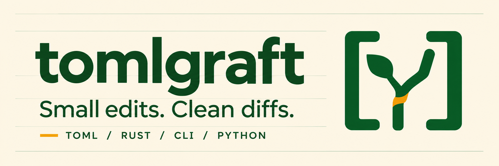

# tomlgraft

**Give your configuration a smaller diff.**

Small TOML edits from Python, backed by the same Rust core as the CLI.
Update configuration values, `pyproject.toml` dependencies, and PEP 723 inline
script metadata while preserving untouched bytes, comments, and formatting.
Edits are validated as a batch before any file is replaced.

## Installation

```sh
python -m pip install tomlgraft==0.1.1
# or with uv:
uv add tomlgraft==0.1.1
```

Requires **CPython 3.12**. Prebuilt wheels support Windows x86-64 and Linux
x86-64 with glibc 2.35+. Source builds require Rust 1.89+ and a platform linker.
The extension requires the GIL; no universal ABI or free-threaded Python
support is advertised.

The PyPI package installs **Python bindings** (`import tomlgraft`). Install the
standalone CLI separately with `cargo install tomlgraft --version 0.1.1 --locked`
or use the binaries from [GitHub Releases](https://github.com/snchimata/tomlgraft/releases/tag/v0.1.1).

## Quickstart

### Edit bytes in memory

`patch()` takes source bytes and returns `output` bytes plus a `report`:

```python
import tomlgraft

source = b"[project]\nversion = '1.0.0' # keep this comment\n"
result = tomlgraft.patch(
    source,
    kind="pyproject",
    operations=[{"op": "set", "path": ["project", "version"], "value_toml": "'1.1.0'"}],
)
assert result["output"] == b"[project]\nversion = '1.1.0' # keep this comment\n"
```

Use `kind="toml"` for ordinary TOML, `"pyproject"` for project metadata, or
`"script"` for PEP 723 metadata. Recognized lockfiles remain read-only.
Paths are lists of literal key segments: `["tool", "example.org", "enabled"]`
selects a key containing a dot. `value_toml` is a TOML literal string, such as
`"true"`, `"42"`, or `"'1.1.0'"`.

### Preview or write an existing file

`patch_file()` accepts a string or `PathLike` path, infers the document kind
from the filename, and returns a report:

```python
import tomlgraft

report = tomlgraft.patch_file(
    "pyproject.toml",
    operations=[
        {"op": "set", "path": ["project", "requires-python"], "value_toml": "'>=3.12'"},
        {"op": "dep_upsert", "scope": {"kind": "group", "name": "dev"}, "requirement": "pytest>=8"},
    ],
    dry_run=True,
)
print(report["status"], report["committed"])
```

Preview creates no lock sidecar or staging file. Set `dry_run=False` to apply
the batch; **file writes default to `dry_run=False`**. Cooperating writers use
a sibling lock, stage the validated output, and recheck the target before
atomic replacement on supported local filesystems.

### Manage Python dependencies

Use `dep_upsert` to add or replace a requirement and `dep_remove` to remove one:

```python
import tomlgraft

result = tomlgraft.patch(
    b'[project]\ndependencies = ["requests>=2.30"]\n',
    kind="pyproject",
    operations=[
        {"op": "dep_upsert", "scope": {"kind": "project"}, "requirement": "httpx>=0.27"},
        {"op": "dep_remove", "scope": {"kind": "project"}, "selector": "requests"},
    ],
)
assert result["output"] == b'[project]\ndependencies = ["httpx>=0.27"]\n'
```

| Dependency location | Scope |
| --- | --- |
| `project.dependencies` | `{"kind": "project"}` |
| `project.optional-dependencies.test` | `{"kind": "optional", "name": "test"}` |
| `dependency-groups.dev` | `{"kind": "group", "name": "dev"}` |
| PEP 723 script `dependencies` | `{"kind": "script"}` |

Matching uses normalized package names, sorted normalized extras, and parsed
environment-marker structure. Version specifiers or URLs are replaced in full;
distinct marker and extra variants remain separate. No dependency resolver or
installer runs.

### Add PEP 723 script metadata

Creating a missing `# /// script` block requires `create_script_block=True`.
Both APIs default to `False`. The Python script is never executed:

```python
import tomlgraft

source = b"print('hello')\n"
result = tomlgraft.patch(
    source,
    kind="script",
    operations=[
        {"op": "dep_upsert", "scope": {"kind": "script"}, "requirement": "rich>=13"},
    ],
    create_script_block=True,
)
assert result["output"].startswith(b"# /// script\n")
assert result["output"].endswith(source)
```

## Preservation and validation

| What you need | What tomlgraft does |
| --- | --- |
| Focused diffs | Preserves bytes, comments, key order, quote styles, LF/CRLF, and final-newline state outside the edit. Whole-document serialization is never a fallback. |
| Ordered batches | Prepares and validates all operations in memory. A failed operation produces no partial output or target write. |
| Protected metadata | Refuses changes to fields remaining in `project.dynamic` and treats recognized `pylock.toml` files as read-only. |
| Explicit refusals | Rejects ambiguous layouts, unsupported edits, and file metadata it cannot preserve. |
| Local operation | Runs no Python scripts, build backends, resolvers, subprocesses, or network requests. |

`set`, `remove`, `dep_upsert`, and `dep_remove` work through both APIs.
Removing a leaf also removes its same-line comment; standalone comments remain.
Table deletion and arrays of tables are unsupported. See the
[preservation contract](https://github.com/snchimata/tomlgraft/blob/main/docs/reference.md#preservation-and-metadata)
for supported layouts, dependency identity, and script discovery.

## Error handling and file safety

Core errors inherit from `tomlgraft.PatchError`: `ArgumentError`,
`DocumentError`, `ConflictError`, `UnsupportedError`, and `TransactionError`.
They expose `code`, zero-based `operation` (when available), `committed`,
`durability`, `exit_code`, and `report`.

Inspect **`committed` and `durability`** in file reports and exceptions.
A failure after replacement can report `committed=True`; after interrupted
or lost output, reread the target before retrying.

This is an **experimental release**. Writes are qualified only for existing
regular files on local **Windows x86-64/NTFS** and **Linux x86-64/ext4**, within
the documented metadata restrictions. Other platforms/filesystems support
in-memory edits and previews; direct writes are refused. Windows directory
durability is uncertain, and noncooperating editors can race the final
recheck/rename. See the
[file transaction contract](https://github.com/snchimata/tomlgraft/blob/main/docs/reference.md#file-transactions).

## Performance

Recorded local medians for Python in-memory preparation of a 500-line manifest
were **0.083 ms on Linux/WSL2** and **0.087 ms on Windows** (30 samples per
platform, AMD Ryzen 7 9800X3D, CPython 3.12, Rust 1.97 release builds).
These include binding conversion and preparation, exclude file I/O, and are
descriptive measurements rather than latency guarantees. See
[methodology and raw samples](https://github.com/snchimata/tomlgraft/blob/main/docs/verification/build-test.md#descriptive-measurements).

## Documentation

- [Python API reference](https://github.com/snchimata/tomlgraft/blob/main/docs/reference.md#python-and-rust)
- [Runnable Python and Rust examples](https://github.com/snchimata/tomlgraft/tree/main/examples)
- [CLI documentation](https://github.com/snchimata/tomlgraft#cli)
- [Release notes](https://github.com/snchimata/tomlgraft/blob/main/docs/releases/v0.1.1.md)
- [Source and Apache 2.0 license](https://github.com/snchimata/tomlgraft)
